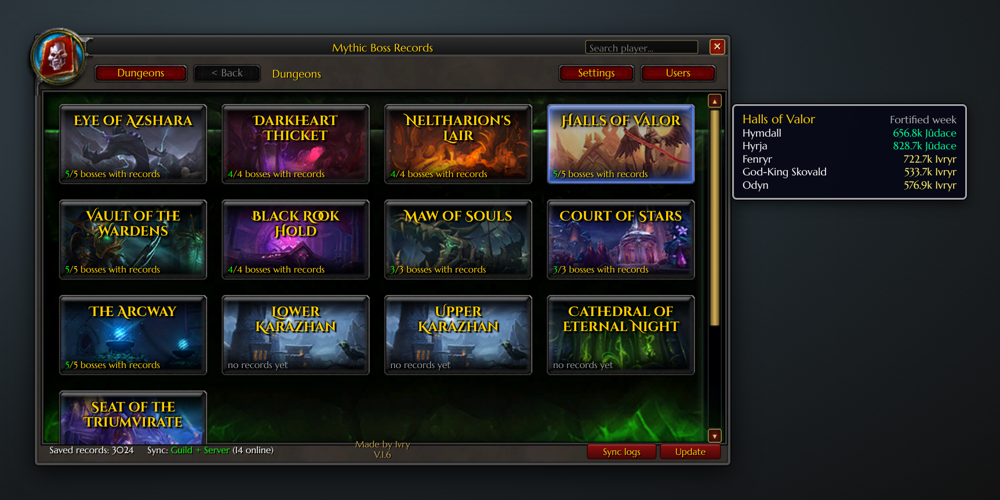
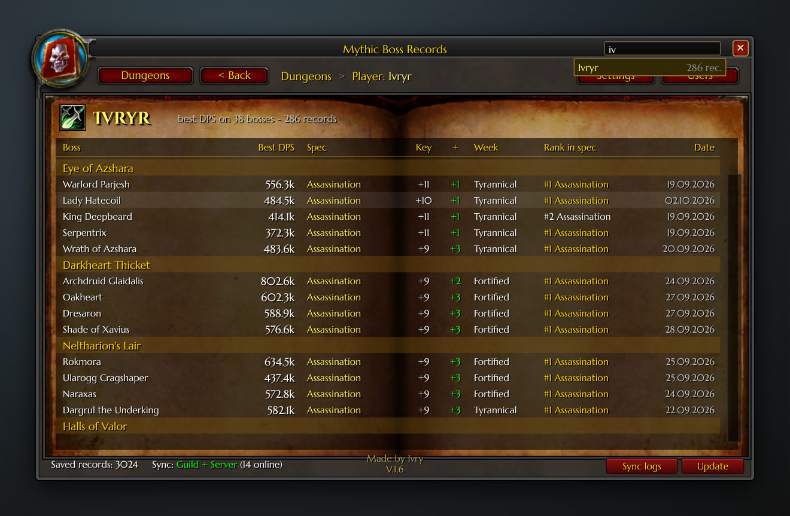

# Mythic Boss Records

WoW **Legion 7.3.5** addon (Tauri). Best boss DPS in Mythic+ for every boss, class and spec, shared between everyone who has the addon.



## Features

- **Boss-only DPS.** Adds don't count. Only keys **+9 and higher**.
- **Tyrannical / Fortified.** Separate tops for each, and the window follows the current week.
- **Class tops per boss.** Classes are sorted best to worst.
- **Shared automatically.** Records sync with your guild and with everyone on the server who has the addon (hidden channel `MBRSync`).
- **Your combat log counts.** MBR Tools reads your `WoWCombatLog.txt` and the addon shares the results.
- **Player search.** See any player's records.
- **In-game buttons:** `Update`, `Sync logs`, `Users` (who has the addon), `Settings`.

| Boss & classes | Top DPS | Player search |
|---|---|---|
|  |  |  |

## Install

1. Download `MythicBossRecords.zip` from [Releases](../../releases/latest).
2. Extract it to `World of Warcraft\Interface\AddOns\` so you get `AddOns\MythicBossRecords\MythicBossRecords.toc`.
3. Double-click **`MBR Tools.cmd`** in that folder and choose **1 – Turn on automatic**. Do this once.

Step 3 sets up a Windows task that runs every 15 minutes and at logon. It:
- imports new boss fights from your combat log;
- installs new addon versions from this page.

In game, type `/combatlog` before a key so WoW writes the log.

## Buttons

| Button | What it does |
|---|---|
| **Update** | Turns green when someone has a newer version. Click it for the steps. MBR Tools installs updates automatically, then restart WoW. |
| **Sync logs** | Shares the records from your combat log with everyone again. |
| **Users** | Shows who has the addon: name, guild, version, last seen. |
| **Settings** | Turn guild, server or friend sync on or off, chat announcements, the minimap button, and records per spec. |

## Commands

```
/mbr              open / close
/mbr settings     settings
/mbr users        who has the addon
/mbr status       current key and loaded data
/mbr sync now     sync now
/mbr block Name   ignore a player's data
```

## Privacy

- Your combat log is read **only on your PC**. Nothing is uploaded.
- The addon shares only boss records in game (name, class, spec, DPS, key).
- MBR Tools only downloads releases from this repository.

---
Made by **Ivry** · Miracle · Evermoon
