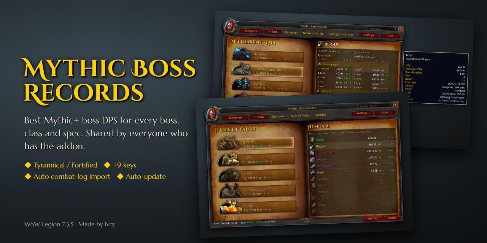
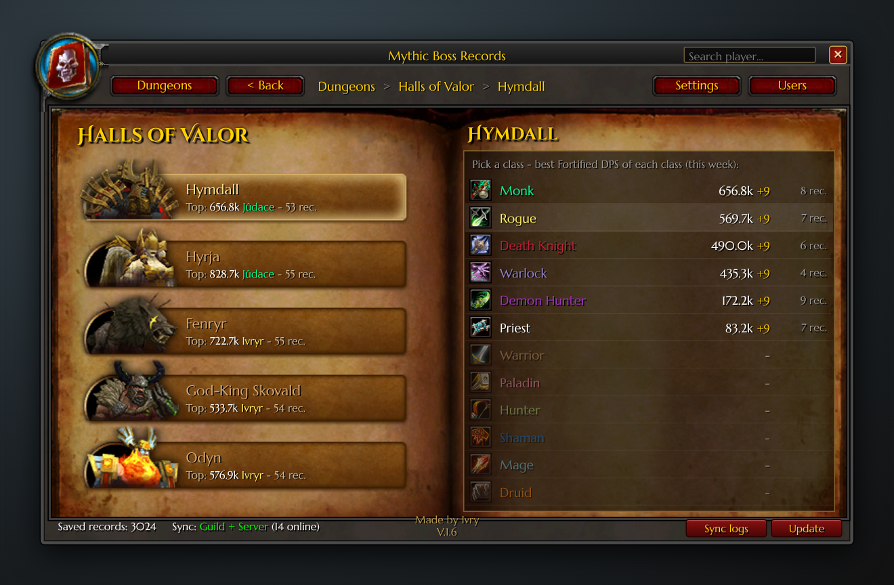
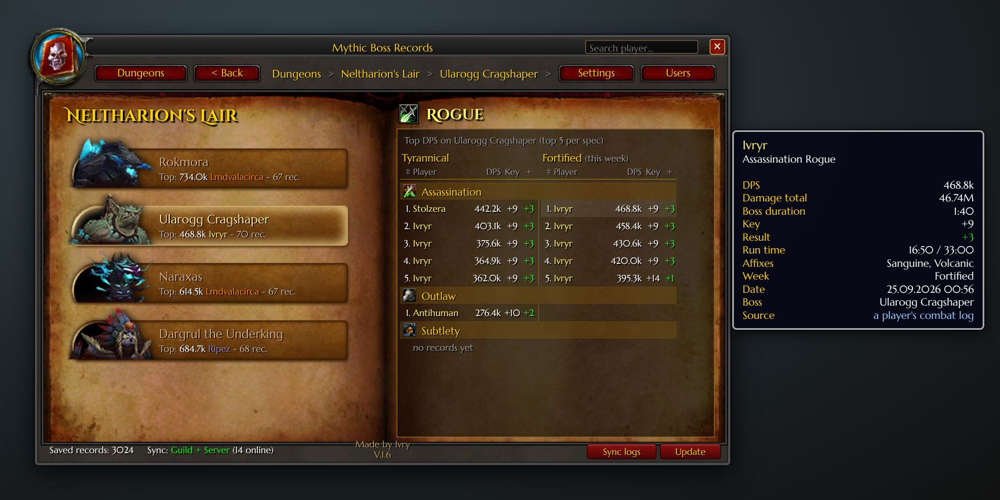
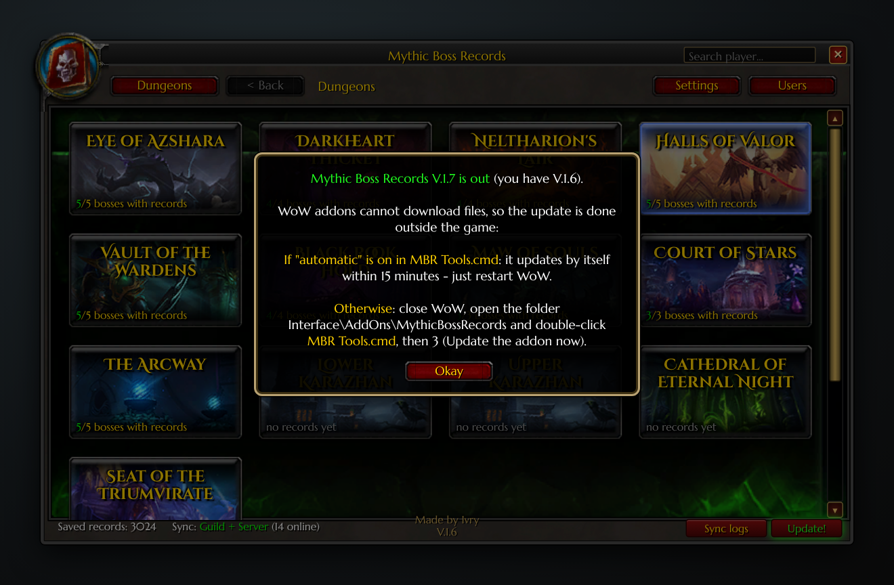
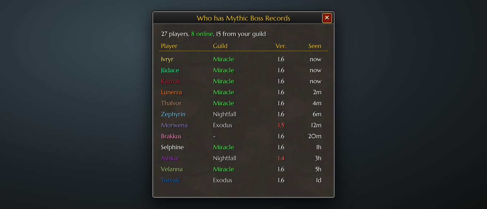
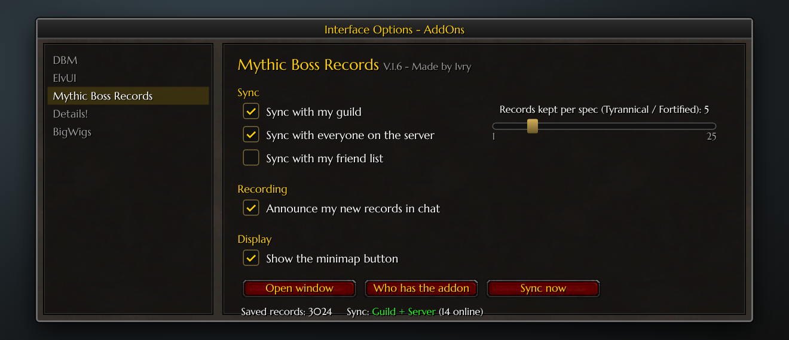
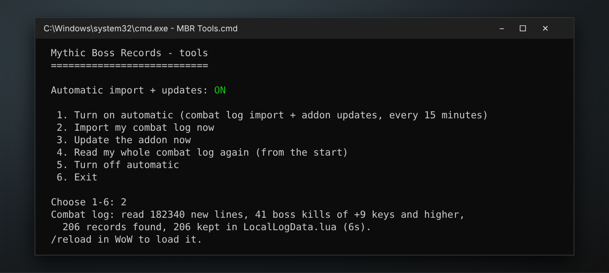

# Mythic Boss Records

WoW **Legion 7.3.5** addon (Tauri). Shows the best boss DPS in Mythic+ for every boss, class and spec. Records are shared between everyone who has the addon.

**[⬇ Download MythicBossRecords.zip](https://github.com/Ivry-WOW/MythicBossRecords/raw/main/MythicBossRecords.zip)** · [Changelog](CHANGELOG.md)

## Features

- **Boss-only DPS.** Adds don't count. Only keys **+9 and higher**.
- **Tyrannical / Fortified.** Separate tops; the window follows the current week.
- **Class tops per boss**, sorted best to worst.
- **Shared automatically** with your guild and everyone on the server who has the addon.
- **Your combat log counts.** MBR Tools reads `WoWCombatLog.txt`; the addon shares the results.
- **Auto-update.** New versions install by themselves.

## Screenshots

**Dungeons.** The tooltip shows each boss's top for this week's affix.


**Boss and classes.** The best DPS of each class, sorted.


**Top DPS per spec.** Tyrannical | Fortified, with full fight details.


**Player search.** Every record of a player.


**Update.** The button turns green when a new version is out.


**Users.** Who has the addon and which version.


**Settings.**


**MBR Tools.** Combat-log import and updates, outside the game.


## Install

1. Download **[MythicBossRecords.zip](https://github.com/Ivry-WOW/MythicBossRecords/raw/main/MythicBossRecords.zip)**.
2. Extract it to `World of Warcraft\Interface\AddOns\`. You should get `AddOns\MythicBossRecords\MythicBossRecords.toc`.
3. Double-click **`MBR Tools.cmd`** in that folder and choose **1 – Turn on automatic**. You only do this once.

From then on MBR Tools runs by itself (also after Windows starts):
- every minute it checks this page and installs a new addon version;
- every 15 minutes it imports new boss fights from your combat log.

In game, type `/combatlog` before a key so WoW writes the log.

## Buttons

| Button | What it does |
|---|---|
| **Update** | Turns green when someone has a newer version. MBR Tools installs it; restart WoW. |
| **Sync logs** | Shares the records from your combat log with everyone again. |
| **Users** | Who has the addon: name, guild, version, last seen. |
| **Settings** | Guild, server or friend sync; chat announce; minimap button; records per spec. |

## Commands

```
/mbr              open / close
/mbr settings     settings
/mbr users        who has the addon
/mbr status       current key and loaded data
/mbr sync now     sync now
/mbr block Name   ignore a player's data
```

## Privacy

- Your combat log is read **only on your PC**. Nothing is uploaded.
- In game, the addon shares only boss records (name, class, spec, DPS, key).
- MBR Tools downloads updates only from this repository.

---
Made by **Ivry** · Miracle · Evermoon
